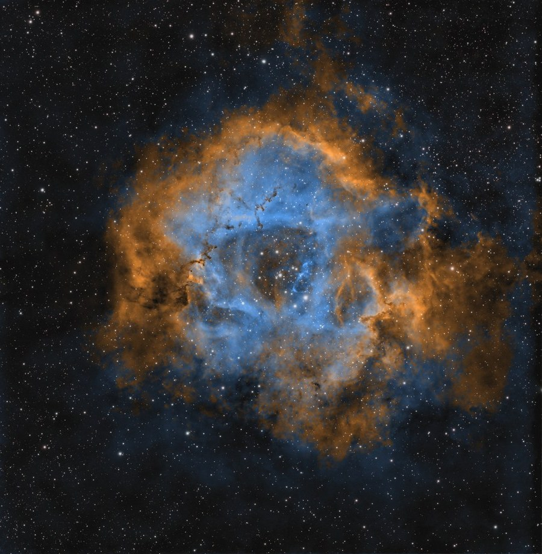
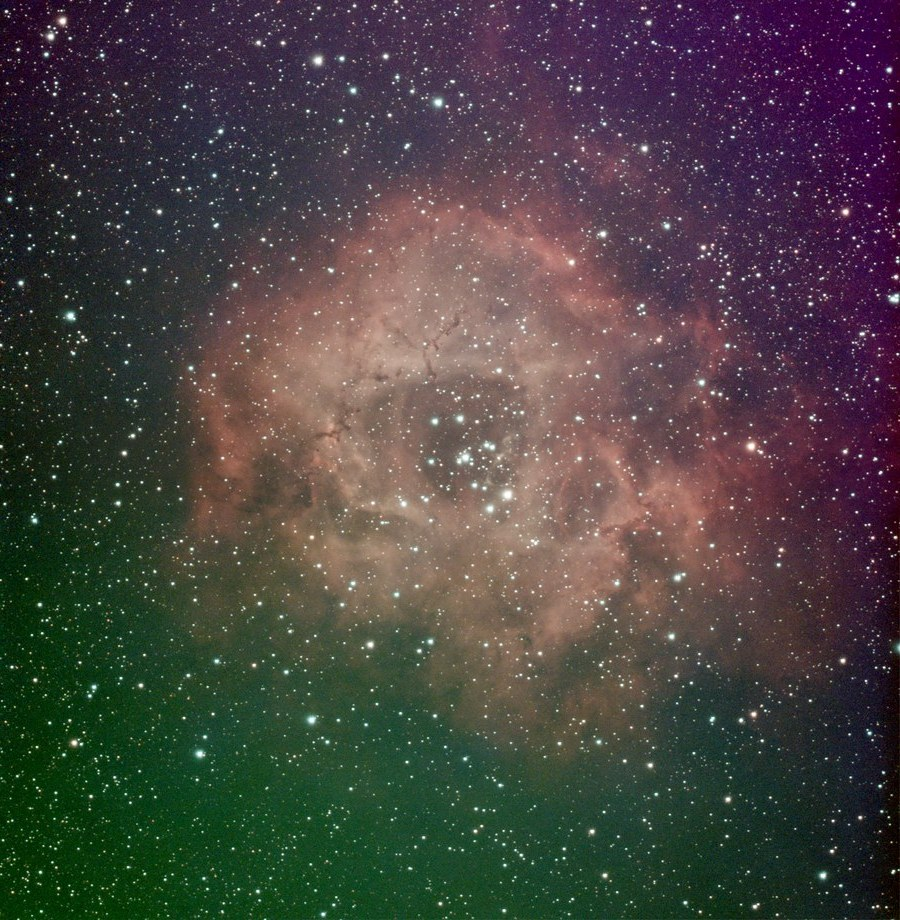
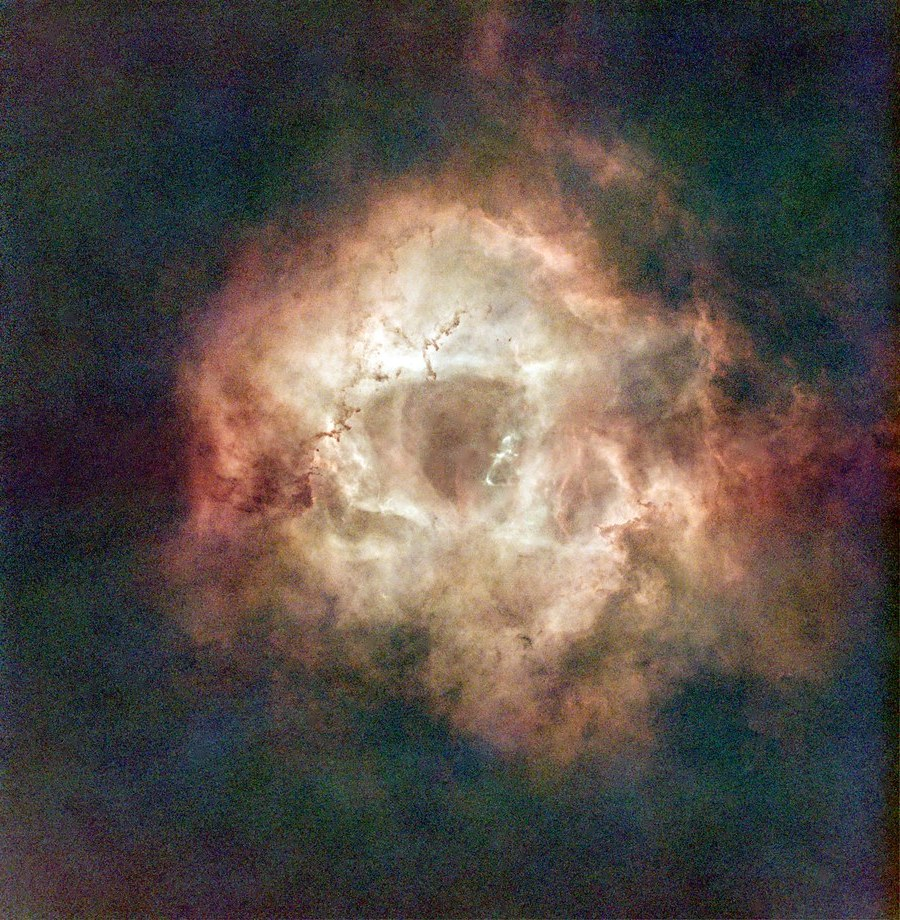
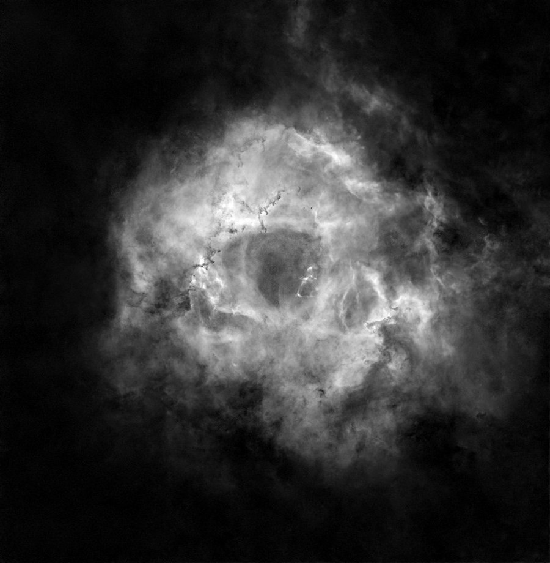
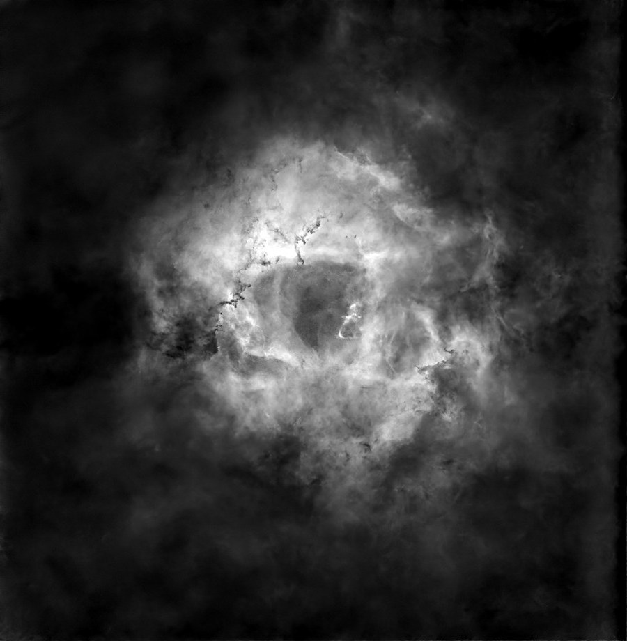

# Blue and gold from duo-band data: my DWARF Mini workflow, step by step

How I made the Hubble-inspired Rosette ([AstroBin](https://app.astrobin.com/i/u0bd2k), revision D) from a 30 mm smart telescope on a city balcony. Every number below is the setting actually used on this image. The linear stack is [here](https://github.com/tepliyk/astro-data/releases/tag/data-ngc2244-rosette) if you want to follow along with the same data.



**Data:** DWARF Mini in EQ mode, built-in duo-band filter, gain 80, 2-panel mosaic, 60 s subs over 10 nights. Panel 1: 731 subs (12.2 h), panel 2: 684 subs (11.4 h), 23.6 h in total. Each part of the image has roughly half of that, only the overlap between the panels has both.

## Disclosure: what is neural-network processing and what is not

- **Neural-network tools used:** BlurXTerminator (deconvolution), StarXTerminator (star removal), NoiseXTerminator (noise reduction), and GraXpert background extraction, which uses its own AI model in CLI mode. They change detail, noise and stars, they do not add objects.
- **No generative AI.** Nothing in the image was generated or painted in. The colour step ([hubble_map.py](../scripts/hubble_map.py)) is a plain mathematical remapping of the two measured channels, every formula is in the code.
- **False colour.** This is a Hubble-inspired palette, not SHO: there is no SII channel. Colours show a chosen mapping of two independently stretched signals, not measured line ratios or the actual amounts of hydrogen and oxygen.

## Software and versions

| Step | Used on this image | Free alternative |
|---|---|---|
| Stacking | Siril 1.4.4 | same |
| Gradient removal | own polynomial fit (RGB), GraXpert 3.1.0rc2 (each channel) | Siril Background Extraction |
| Deconvolution (optional) | BlurXTerminator, RC-Astro CLI 2.6.9 (stars 0.25, non-stellar 0.60) | skip it, or Siril deconvolution |
| Star removal | StarXTerminator, RC-Astro CLI 2.6.9, ML model 11 | StarNet (built into Siril) |
| Noise reduction | NoiseXTerminator, RC-Astro CLI 2.6.9, ML model 3.1 | GraXpert denoising, Siril denoise |
| Colour mapping | [hubble_map.py](../scripts/hubble_map.py) (Python) | Siril PixelMath, see step 9 |

The BlurXTerminator model version was not logged for this run. Python: `pip install numpy scipy astropy tifffile pillow`

## 1. Collect the raw subs, not the in-app stacks

The Mini keeps every sub as FITS in `Astronomy/DWARF_RAW_TELE_<target>_<date>/`. A mosaic has one subfolder per panel. Copy the subs of one target (or one panel) from **all nights** into a single `lights/` folder.

Why not combine the nightly in-app stacks? Inside a finished stack you can no longer reject bad frames. Restacking all subs together let me drop cloudy and trailed frames across all nights and weight the rest by quality. On another target this gave about 20% better signal-to-noise than combining nightly stacks.

## 2. Calibration frames

In the `CALI_FRAME` folder of the Mini:

- **Darks:** `dark/cam_0/dark_exp_60.000000_gain_80_*` with the same exposure and gain as your lights. I took the ones recorded at 18 to 26 °C, the range of my nights, and stacked them into a master dark in Siril (`stack dark rej 3 3 -nonorm`).
- **Flat and bias:** `flat/cam_0/flat_gain_2_bin_1_ir_2.fits` and `bias/cam_0/bias_gain_2_bin_1.fits`, used as they are.

## 3. Stack in Siril

The script [siril_dwarf_panel.ssf](../scripts/siril_dwarf_panel.ssf) does everything in one run. The key lines:

```
calibrate light -dark=../master_dark -flat=../master_flat -bias=../master_bias -cfa -equalize_cfa -debayer
register pp_light -2pass
seqapplyreg pp_light -filter-wfwhm=90% -filter-round=90% -filter-bkg=90%
stack r_pp_light rej w 3 3 -norm=addscale -output_norm -rgb_equal -filter-included -weight=wfwhm -out=../stack
```

- `-cfa -equalize_cfa -debayer`: the Mini is a colour camera, debayer after calibration.
- `-filter-...=90%`: keep the best 90% by star sharpness (FWHM), roundness (tracking) and background (clouds, light pollution). This removes the bad frames from all nights at once.
- `rej w 3 3`: winsorized sigma clipping, removes satellites and hot pixels.
- `-weight=wfwhm`: sharper frames count more.



*The stack with a quick auto-stretch. Green and purple gradients are light pollution, they go in step 5.*

## 4. Mosaic (skip if you shot one panel)

Siril can build the mosaic itself: `seqplatesolve`, then `register -astrometric`, then `stack ... -overlap_norm`. Plate solving needs a star catalogue. The online one was down for me, so install the local Gaia catalogue in Siril (Catalog_Installer script) and it works offline.

I joined the two panels in Python with `astroalign` (star-based alignment) and a 120 px feathered seam, then cropped the empty borders. Either way the result is one linear RGB image.

## 5. Gradient, deconvolution, star removal

On the linear RGB image:

1. **Gradient removal.** I fitted a 2nd-order polynomial to the frame edges, where there is no nebula, and subtracted it. Siril Background Extraction does the same job.
2. **Deconvolution (optional).** BlurXTerminator with stars 0.25 and non-stellar 0.60. Mostly tightens the bloated stars at 150 mm.
3. **Star removal.** StarXTerminator with "stars" output, so you get two files: a starless image and a stars-only image. Keep both, the stars go back at the end.



*Starless, still in natural colour.*

## 6. Split into Ha- and OIII-dominated channels

With a duo-band filter on a colour camera, Ha (656 nm) falls mostly on the red pixels and OIII (501 nm) mostly on the green and blue ones. As a practical approximation:

- **Ha-dominated channel = R**
- **OIII-dominated channel = (G + B) / 2**

These are estimates, not clean line extraction: the real mix depends on the filter and on the spectral response of the sensor.

```
python split_ho.py starless.fits .
```

[split_ho.py](../scripts/split_ho.py) writes `Ha.fits` and `OIII.fits`. In Siril the same is Extraction → Split channels, then PixelMath `(G+B)/2`.

## 7. Clean each channel separately

From here Ha and OIII are two separate mono images, and the OIII signal is several times weaker, so it gets more noise reduction.

1. **GraXpert background extraction** on each: correction Subtraction, smoothing 0.5. A gradient left in one channel turns into colour blotches later.
2. **Noise reduction, stronger on OIII:** NoiseXTerminator 0.75 on Ha, 0.95 with 3 iterations on OIII. The OIII denoising is heavy, so compare with the linear stack before trusting fine OIII structure.

| Ha-dominated | OIII-dominated |
|---|---|
|  |  |

*Both after cleaning and stretching.*

## 8. Normalise and stretch each channel separately

This is the main trick for blue and gold. If both channels get the same treatment, OIII stays dim and the gold swallows the blue.

1. **Normalise:** each channel is scaled from its own 2nd percentile (black point) to its own 99.97th (Ha) or 99.9th (OIII) percentile. Here the OIII range was about 4.4 times narrower than Ha, so this step alone amplifies OIII about 4.4 times more.
2. **Stretch:** a midtones transfer that puts the 75th percentile of each channel at a target: **0.30** for Ha, **0.255** for OIII.

So OIII is boosted relative to Ha by the independent normalisation and stretch, which is exactly why the result is false colour (see the disclosure above).

**Black point: 2nd percentile, not the median.** A median black point sets half of the pixels to zero. In my first version this clipped the background and the faint outer wisps. Measured on this data before any pedestal: about 50% of the pixels at the black point with the median, 2.25% with the 2nd percentile.

## 9. Map the colour

The easy way is a linear mix, which works in Siril PixelMath (three expressions, RGB output):

```
R = Ha + 0.36 * OIII
G = 0.60 * Ha + 0.66 * OIII
B = 0.22 * Ha + OIII
```

The catch: where both channels are strong, all three RGB channels go high and the core turns white. The classic Foraxx formula did the same on this data.

What [hubble_map.py](../scripts/hubble_map.py) does instead, step by step:

1. **Brightness**, a weighted sum of both channels: `L = 0.55 * Ha + 0.45 * OIII`, then a small extra midtone transfer (0.47).
2. **OIII share** in each pixel, from the stretched values: `t = OIII / (Ha + OIII)`.
3. **Rescale `t`** using only the brightest 40% of pixels (above the 60th percentile of `L`), a simple stand-in for "the nebula" on this frame: the 14th percentile of `t` there becomes 0, the 94th becomes 1, values outside are clipped.
4. **Smooth `t`**: Gaussian blur with sigma 1.5 px, then a smoothstep curve `t² (3 - 2t)` for a softer transition.
5. **Colour**: gold `(1.0, 0.60, 0.22)` blended to blue `(0.36, 0.66, 1.0)` by `t`.
6. **Combine**: colour times `L`, divided by the mean of the colour and multiplied by 0.62, so gold and blue pixels of the same `L` come out equally bright.

Since brightness and hue are separate, the core can be bright and still blue.


*Gold where the Ha-dominated channel is relatively stronger after stretching, blue where the OIII-dominated one is. It follows the known structure of the Rosette (oxygen emission around the hot young stars of NGC 2244, hydrogen further out), but it shows the chosen mapping, not measured line ratios.*

## 10. Finish

Also in the script, all optional:

- **Neutral background:** below brightness 0.12 the colour fades to grey, so noise in the background does not turn into blue and gold blotches.
- **Local contrast:** 0.35 on a 60 px scale. Darkens the central cavity, brings out the ring.
- **Saturation:** 1.12.
- **Pedestal:** the whole image is lifted by 0.06, so the black point becomes dark grey (about 15/255) instead of pure black. This is cosmetic: it does not recover any shadow detail that was cut at the black point in step 8.

## 11. Stars back, and check the shadows

- The stars-only image is stretched separately (midtone 0.03), its colour reduced to 45%, and added back with a screen blend at 0.8. Muted stars do not compete with the nebula and avoid pink halos.
- **Check how much sits at the black point.** The script prints the share of pixels at the black point *before* the pedestal, which is the real shadow loss. Here it is 2.25%. If yours is high, lower `--lo`. Checking the final histogram is not enough, because the pedestal lifts everything off zero anyway.

```
python hubble_map.py --ha Ha.fits --oiii OIII.fits --stars stars.fits --out rosette
```

All the numbers above are the script defaults, tuned on this Rosette. On other data, for example another smart telescope with a duo-band filter, the method should carry over to linear RGB data, but expect to adjust the stretch targets and the `t` percentiles. Add `--flip` if the image comes out upside down (some tools write FITS bottom-up).

## Summary

1. Restack all raw subs from all nights in Siril, with filtering by FWHM, roundness and background.
2. Remove gradients and stars while still linear.
3. Split into Ha-dominated (R) and OIII-dominated ((G+B)/2) channels, clean each separately.
4. Normalise and stretch them separately; black point at a low percentile, not the median.
5. Brightness from both channels, hue from the OIII share.
6. Neutral background, stars back muted, check the shadow loss before the pedestal.
7. Disclose the neural-network tools and that the colours are a false-colour mapping.

Questions are welcome on Reddit (u/Different_Crew_8867) or in my Telegram channel [Nebo Blyzhche](https://t.me/nebo_blyzhche). Night-by-night log for this target: [tepliyk.github.io/en/ngc-2244](https://tepliyk.github.io/en/ngc-2244/).
